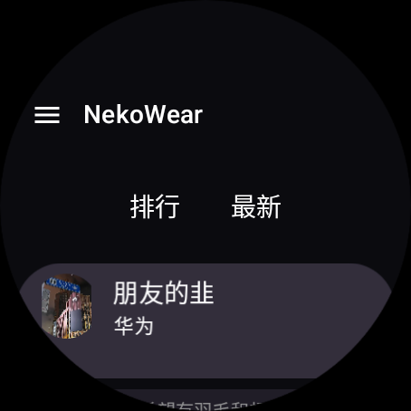
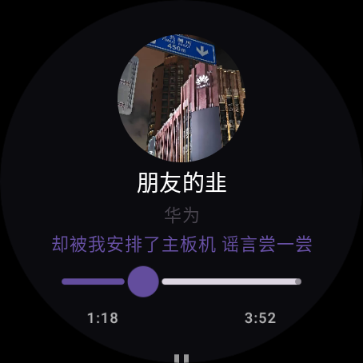
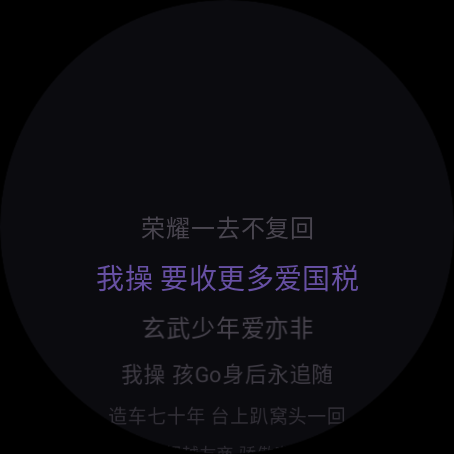
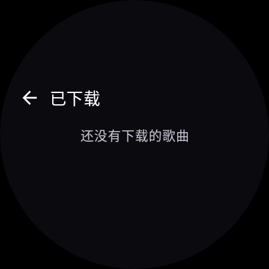
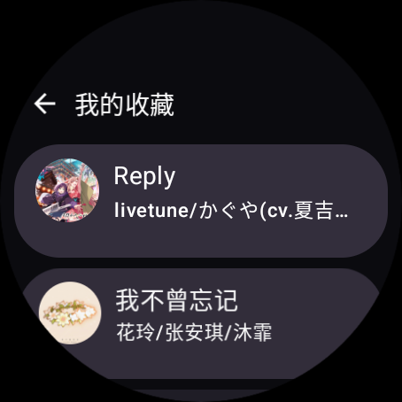

# NekoWear



NekoMusic 的 **Wear OS 原生客户端**，用 Kotlin + Jetpack Compose for Wear OS 编写。
直接对接 NekoMusic 后端，不内置任何音源；曲库、账号、歌单来自你自己的服务端。

> 当前版本：`0.1.0`（开发中，功能持续补齐）

---

## 为什么做这个

官方 Android 客户端在手机上很好用，但手表上没有对应版本。而手表场景很具体：
屏幕只有 1.4 寸、圆形、没有键盘，还经常在没网的环境下听歌。

NekoWear 就是按这些约束重写的：所有操作都能用滑动和点击完成，播放走系统媒体会话，
下载后可以完全离线播放。

## 功能

**浏览与播放**

- 排行榜 / 最新上架，圆屏缩放列表
- 点歌直接播放，音质接口解析出真实媒体地址后交给 ExoPlayer
- 播放页：圆形封面、歌名歌手、当前歌词一行、可拖动进度条、上一首 / 暂停 / 下一首
- 左右滑动在「播放控制」和「歌词」两页之间切换
- 右滑返回上一页，整页跟手位移
- 除播放页外，所有页面底部常驻迷你播放条
- 播完自动下一首

**离线**

- 列表左滑露出「下载」，缓存到本地后断网也能播
- 「已下载」页：右上角多选批量删除，底部「全部删除」带确认弹窗
- 断网启动时自动回退到已缓存歌曲列表

**账号**

- 扫码登录：手表显示二维码（可点按放大铺满屏幕），用手机 NekoMusic 扫一扫确认
- 我的收藏 / 我的歌单 / 歌单内容，均带封面展示

## 截图

| 播放页 | 歌词页 |
|---|---|
|  |  |

| 已下载 | 我的收藏 |
|---|---|
|  |  |

| 扫码登录 |
|---|
|  |

## 技术栈

| 项 | 说明 |
|---|---|
| UI | Jetpack Compose for Wear OS Material 3（`ScalingLazyColumn` 圆屏缩放） |
| 播放 | Media3 `ExoPlayer` + `MediaSessionService`（锁屏、表盘、耳机按键统一走系统） |
| 网络 | Ktor 3（OkHttp 引擎）+ kotlinx.serialization |
| 图片 | Coil 3 |
| 最低版本 | Wear OS 3 / Android 8.0（API 26） |
| 依赖 | 无第三方 UI 框架 |
| 体积 | release 包约 2.5 MB（R8 + 资源裁剪） |

## 构建

```bash
# 调试
./gradlew :app:assembleDebug

# 发布（R8 + 资源裁剪）
./gradlew :app:assembleRelease
```

签名信息放在项目根目录的 `keystore.properties`（已在 .gitignore 中）：

```properties
storeFile=/path/to/your.jks
storePassword=******
keyAlias=******
keyPassword=******
```

首次构建还需要 `local.properties` 指向 Android SDK：

```properties
sdk.dir=/path/to/Android/sdk
```

## 代码结构

```
data/       ApiConfig（域名与请求头）NekoApi（接口）NonceClient（防重放）Models（数据类）
player/     PlayerManager（全局 ExoPlayer）PlaybackService（MediaSessionService）
ui/         HomeScreen / MenuScreen / DownloadsScreen / AccountScreens / PlayerScreen
            SharedUi（迷你播放条 + 左滑下载行）Lrc（歌词解析）Theme
MainViewModel.kt   统一状态机：列表、播放、缓存、账号、收藏歌单
```

## 客户端身份 v1（实例签名）

后端要求受保护接口证明「哪个应用 + 哪个安装实例」在请求，由 `data/ClientIdentity.kt` 实现：

1. 本机生成 EC P-256 密钥对，私钥 PKCS8 / 公钥 SPKI 存应用私有 `SharedPreferences`
2. `GET /api/client/challenge?purpose=register` 取挑战 → 用私钥签名 → `POST /api/client/register`
3. 服务端返回实例令牌（带过期时间），到期前自动 `/api/client/token` 续签
4. 每个受保护请求附带 `X-Neko-Client-Id/Instance/Token/Timestamp/Signature`

签名串（字段顺序固定）：

```
neko-client-v1
<METHOD>
<PATH>
<RAW_QUERY>
<client_id>
<instance_id>
<platform>
<timestamp>
<body_sha256_hex>
<nonce>
```

### 平台标记（容易踩）

| 位置 | 取值 |
| --- | --- |
| `X-Neko-Client` | `androidwatch+<版本>` |
| `User-Agent` | `NekoMusic-AWatch/<版本>` |
| 挑战 / 注册参数 `platform` | `androidwatch` |

后端把 UA 分类成 `awatch`，与自报的 `androidwatch` 分别精确匹配。UA 写成
`NekoMusic-android/...` 会被判成手机端而 401，写成 `NekoMusic-androidwatch/...` 会被判成非官方客户端而 403。

客户端 ID 是后端登记的公开客户端 `nkc_pub_android_watch_prod`（无 secret）。
注册时未附 Android Key Attestation 证书链，服务端会把可信等级降级为 `software`，
仍以挑战签名验证实例私钥。

## 防重放（PoW + 一次性 nonce）

后端对受保护接口要求一次性 `X-Neko-Nonce`，由 `data/NonceClient.kt` 统一管理：

1. `GET /api/replay/challenge?read=N&write=M` 换题，拿到 `challenge` / `seed` / `difficulty`
2. 本地求 `SHA-256("<seed>:<counter>")` 前导零比特数 ≥ `difficulty` 的最小 counter
3. `GET /api/replay/nonce?challenge=…&proof=…` 兑换一批 nonce，按读/写分池缓存
4. 每个 nonce 只用于一次请求，取出即消耗，即使请求失败也不回池

实现要点：

- **读写分池**：GET 与其它 HTTP 方法在服务端是两个独立池，混用会直接 409
- **单飞补货**：并发缺货时只换一次题、只解一次 PoW，其余协程等锁复用结果
- **求解可控**：难度夹紧到 32 以内，20 秒超时，循环每 8192 次检查取消
- **409 处理**：只作废对应方向的池并换题重试（最多 3 次）；**429** 不重试，直接提示用户
- **启动预热**：`MainViewModel` 初始化时后台预取读池，首次播放不必等 PoW

## 已知问题

- `MainViewModel` 承担了过多职责，后续计划拆成播放 / 缓存 / 账号 / 曲库四块
- 迷你播放条的尺寸与配色仍是散落的字面量
- 搜索、歌单创建、听歌识曲尚未实现

## 免责声明

本项目仅用于学习与个人自建服务的技术交流，不提供、不存储、不分发任何音乐资源。
曲库内容、账号数据均由使用者自行搭建的服务提供，音乐版权归各版权方所有。
请勿将本项目用于任何商业用途。

## 许可证

[GNU Affero General Public License v3.0](LICENSE)
